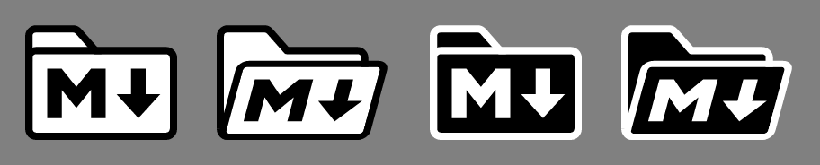

# The MDZip Mark

Use this mark to identify MDZip (.mdz) files, tools, and integrations.

The MDZip Mark combines a folder shape with the Markdown "M" and down arrow, connecting MDZip archives to their Markdown-based contents.

## History

This mark is based on the visual language of [The Markdown Mark](https://github.com/dcurtis/markdown-mark), designed by [Dustin Curtis](https://dustincurtis.com/) to identify Markdown support. MDZip uses the same recognizable "M" and down arrow as a reference point, then places it inside a folder form to represent Markdown packaged as an archive.

## Design

The mark is built as a simple, high-contrast folder icon so it remains readable at small sizes. The primary artwork is kept in SVG, with raster exports provided for application icons and file associations.

## Usage

Use the MDZip Mark anywhere MDZip support needs to be identified, such as file icons, application icons, documentation, or tool UI.

Please keep these guidelines in mind:

1. Maintain the original proportions of the folder, Markdown glyph, and arrow.
2. Prefer the supplied SVG, PNG, or ICO assets instead of redrawing the mark.
3. Use the square variants when a fixed-size app or file icon is needed.
4. Copy the assets into your own project rather than linking to them here. File names and folder layout may change, and raw GitHub URLs are rate-limited and not meant for hot-linking.

## Files

- `svg/` - editable SVG source files.
- `png/` - PNG exports. Non-square exports are indexed by height: `mdzip-mark-h<height>-<width>x<height>.png` (e.g. `mdzip-mark-h096-127x96.png`). The closed and open marks are rendered at the same set of heights, so a given `h<height>` always has a matching pair of equal height. Square exports use `mdzip-mark-square-<size>.png`.
  - `mdzip-mark-macos-<size>.png` (16-1024) - macOS app icon: the mark on a white rounded-square tile following the Apple icon grid (824px tile on a 1024px canvas, soft shadow), from `svg/mdzip-mark-macos.svg`. The 16 and 32 renders use `svg/mdzip-mark-macos-small.svg`, which drops the shadow for a cleaner edge. Use them to build an `.icns`.
  - `mdzip-mark-ios-1024.png` and `mdzip-mark-ios-dark-1024.png` (1024) - iOS app icon: light (opaque white, full-bleed; iOS rounds the corners) and dark (light mark on transparent), from `svg/mdzip-mark-ios.svg` and `svg/mdzip-mark-ios-dark.svg`. Use them for an Xcode asset catalog's Any and Dark appearances. Tinted is not provided.
- `ico/` - Windows icon exports.
- `*/dark/` - dark-mode (inverted) assets, mirrored inside each format folder.
- `media/` - composite images for documentation (not distributable marks), plus profile pictures:
  - `mdzip-mark-avatar-circle.png` (1200×1200) - for sites that crop avatars to a circle (AlternativeTo, GitHub, Reddit, Discord, Bluesky). The whole mark fits inside the circle.
  - `mdzip-mark-avatar.png` (1000×1000) - for sites that show the avatar square. Its corners are cut off in a circle crop.
- `reference/` - reference artwork used while designing the mark.
- `font/` - `mdzip-icons.woff`, an icon font holding the marks as single-colour glyphs, for UI that can only show text and font icons (e.g. a VS Code status bar via `contributes.icons`). See below.

## Icon font

`font/mdzip-icons.woff` has three glyphs, at stable Private Use Area codepoints (also in `font/mdzip-icons.json`):

| Glyph | Codepoint | Source |
| --- | --- | --- |
| `mdzip-logo` | `U+E900` | `svg/mdzip-mark.svg` (closed folder) |
| `mdzip-logo-open` | `U+E901` | `svg/mdzip-mark-open.svg` (open folder) |
| `mdzip-markdown` | `U+E902` | the plain Markdown mark (`font/src/markdown-mark.svg`), for `.md` files |

A font can only hold filled single-colour outlines, so these are **traced from the SVG marks** (rasterized, then vector-traced), not the SVGs themselves. They are close to, not identical to, the artwork; use `svg/` anywhere you can show an image. There is no dark variant: the glyph takes the text colour. Each glyph is 0.8em tall, wider than 1em (it keeps the mark's proportions), raised slightly so it centres on the middle of digits and capitals in a VS Code status bar (tuned by eye against a screenshot; other hosts may want it nudged), and has a little empty advance on its right so a following label doesn't touch it. The knobs are `LIFT` and `RIGHT_BEARING` at the top of `font/build.mjs`.

To rebuild after changing a mark: `cd font && npm install && npm run build`. The traced outlines land in `font/src/*.svg` so changes are reviewable. As with the other formats, copy the `.woff` into your project rather than linking to it here.

## Variants

- `mdzip-mark` - primary closed-folder mark.
- `mdzip-mark-open` - open-folder mark.
- `mdzip-mark-square` - square-framed primary mark.
- `mdzip-mark-open-square` - square-framed open-folder mark.

Each variant also ships a dark-mode version with black and white inverted, for use on dark backgrounds. Dark assets live in a `dark/` subfolder within each format directory and carry a `-dark` suffix (e.g. `svg/dark/mdzip-mark-dark.svg`), so a file stays self-describing even after it is copied out of this repo.

## License

The MDZip Mark is dedicated to the public domain under [CC0 1.0 Universal](LICENSE).

CC0 covers copyright in these assets. It does not grant trademark rights in the MDZip name or branding.
